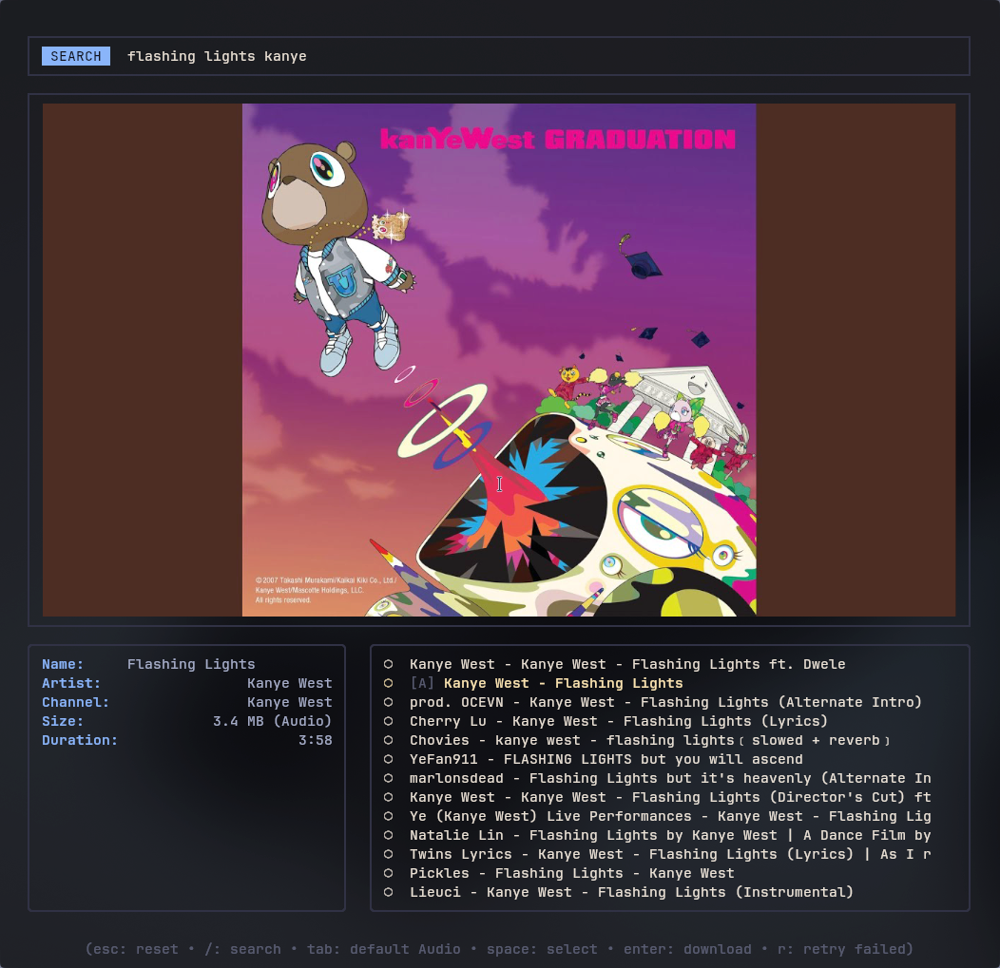
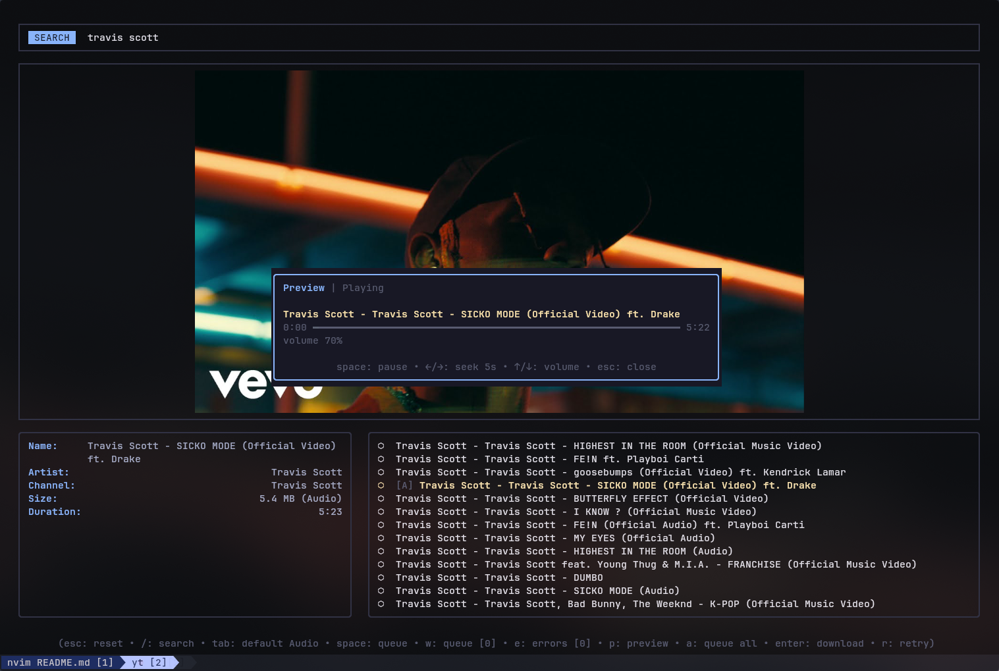

# yt-media

A terminal UI wrapper around [`yt-dlp`](https://github.com/yt-dlp/yt-dlp) for downloading audio or video from YouTube without ever leaving the terminal or pasting the same link into a browser tab. Built with [Bubble Tea](https://github.com/charmbracelet/bubbletea) and [Lip Gloss](https://github.com/charmbracelet/lipgloss).

Search by name, paste a raw video URL, preview the thumbnail in full quality (on [Kitty](https://sw.kovidgoyal.net/kitty/)), queue up as many results as you like, and download them concurrently — organized into your Music/Videos folders automatically.

## Demo

| Search & preview                        | Downloading                      |
| --------------------------------------- | -------------------------------- |
|  |  |

## Features

- **Search or paste** — type a query to search YouTube, or paste a full video URL directly and it's fetched as a single item instead of a search.
- **Real image previews** — thumbnails render as actual high-resolution images via the Kitty graphics protocol, with an ANSI half-block fallback for other terminals.
- **Download queue** — stage items with `space`, then review and start them from a floating queue window (`w`). Each item keeps its own Audio/Video type, and the queue survives restarts.
- **Concurrent batches** — queued items download together through a configurable worker pool, with a progress bar for the whole batch.
- **Error window** — failures are collected in their own window (`e`) with the real yt-dlp message and, on `enter`, the tail of its output. Retry everything with one key.
- **Skip what you already have** — downloads are tracked in a yt-dlp archive file by video ID, so re-running a search you've already downloaded from won't re-fetch anything.
- **Desktop notifications** — get notified when a _batch_ finishes. Only for batches above a configurable size, and (by default) only when the terminal isn't focused.
- **Synced lyrics** — after each audio download, matching lyrics are fetched from [LRCLIB](https://lrclib.net) and saved as `.lrc` files for players like `rmpc`/`mpd` clients. A single command fetches them for your whole existing library. See [Lyrics](#lyrics).
- **Readable errors** — "Network unavailable" instead of `exit status 1`; the full output is always in `debug.log`.
- **Config file, not recompiling** — worker count, default download type, output folders, notification behavior, and more all live in one JSON file.

## Requirements

- [Go](https://go.dev/) 1.24+ (build-time only)
- [`yt-dlp`](https://github.com/yt-dlp/yt-dlp) on your `PATH`
- [`ffmpeg`](https://ffmpeg.org/) (used by yt-dlp for audio extraction/embedding; its `ffprobe` is also used to read tags for lyrics)
- [Kitty terminal](https://sw.kovidgoyal.net/kitty/) for high-resolution thumbnail previews. Other terminals get an ANSI fallback, but Kitty is what this is built and tested on.
- Optional: `notify-send` (Linux) or `osascript` (macOS, built-in) for batch-completion notifications

## Installation

```sh
git clone https://github.com/Dazed-04/yt-media.git
cd yt-media
go build -o yt-media ./cmd/yt-media
./yt-media
```

Move the binary somewhere on your `PATH` (e.g. `~/.local/bin`) to launch it from anywhere. Rebuild and copy it again after pulling updates.

## Usage

1. Press `/` and type a search, or paste a YouTube link. Press `enter`.
2. Move through the results with `↑`/`↓` (or `j`/`k`). The info box shows the title, artist, channel, size and duration.
3. Press `space` to add the highlighted item to the queue. Use `tab` to switch the default type between Audio and Video.
4. Press `w` to open the queue, then `enter` to download everything in it. To grab just one item, press `enter` on it in the result list.

## Configuration

On first run, a default config is written to:

```
~/.config/yt-media/config.json
```

```jsonc
{
  // Number of simultaneous yt-dlp downloads.
  "max_workers": 3,

  // "Audio" or "Video" — the default selected on startup.
  "default_download_type": "Audio",

  // How many results to fetch per search.
  "search_result_limit": 15,

  // Override where files land. Leave blank for ~/Music and ~/Videos.
  "music_dir": "",
  "video_dir": "",

  // Leave blank to use the default location alongside this config file.
  "archive_file": "",

  // Points to shrink the Kitty font by while running, for sharper
  // thumbnails. 0 disables this entirely.
  "font_shrink_delta": 1.5,

  // Desktop notification when a download queue finishes. Only fires for
  // batches (queue size >= notify_min_items), never single downloads.
  "notify_on_batch": true,
  "notify_min_items": 4,

  // Only notify when the terminal isn't focused.
  "notify_only_unfocused": true,

  // Look up synced lyrics (LRCLIB) after each audio download and save them
  // as .lrc files. "yt-media lyrics" does the same for your whole library.
  "fetch_lyrics": true,

  // Where .lrc files go. Blank = a "lyrics" folder inside music_dir, mirroring
  // its folder structure.
  "lyrics_dir": "",

  // Paths (relative to music_dir) to skip, matched as prefixes.
  "lyrics_exclude": [],

  // Also write .srt subtitles next to downloaded videos (when they have none).
  "lyrics_for_video": false,

  // Optional: a command to try when LRCLIB has nothing. {query} and {output}
  // are replaced; no shell is used. Example:
  //   "syncedlyrics {query} -o {output} --synced-only -p musixmatch"
  "lyrics_fallback_command": "",
}
```

Full-line `//` comments are allowed. Edit the file and restart — no rebuild required.

### Higher-resolution previews via Kitty font shrinking (optional)

Kitty renders thumbnails at real pixel resolution rather than ANSI blocks, but resolution is still bounded by how many physical pixels each terminal cell covers — smaller font, more pixels per cell, sharper image (at the cost of smaller UI text everywhere, since font size is a whole-window property). To enable this:

1. In `~/.config/kitty/kitty.conf`, add:

   ```
   allow_remote_control socket-only
   ```

   and reload Kitty's config.

2. Set `font_shrink_delta` in your config to something above `0` (try `1.5`–`3`).

This is entirely optional — leaving it at `0` (or not enabling remote control) just means thumbnails render at your terminal's normal cell density. The font size is restored when you quit.

## Lyrics

With `fetch_lyrics` on (the default), every finished **audio** download gets synced lyrics from [LRCLIB](https://lrclib.net), a free, open lyrics database. Nothing is added to the audio file itself: the lyrics are saved as a separate `.lrc` file, in `lyrics_dir`, mirroring your library's folder structure:

```
~/Music/single/Artist - Song.mp3   →   ~/Music/lyrics/single/Artist - Song.lrc
```

- **Matching** — song titles are messy, so several spellings are tried: the title as-is, then without `(Official Video)`-style decoration, then without `feat.`/`ft.` credits, plus `Artist - Title` uploads are split apart. A result is only accepted if the artist matches and its length is within a few seconds of your file, so you don't get the lyrics of a live or extended version.
- **Skipped automatically** — files that already have an `.lrc`, files that carry embedded lyrics, and anything under a `lyrics_exclude` path.
- **Never blocks a download** — if lyrics can't be found you'll see a short "No lyrics found" note, and the download still counts as done. Details are in `debug.log`.
- **Videos** — set `lyrics_for_video` to also write a `.srt` subtitle file next to downloaded videos (players like mpv and VLC load it automatically). Videos that already have subtitles are skipped. Music videos often differ in length from the studio track, so expect fewer matches than for audio.
- **Extra source** — `lyrics_fallback_command` runs your own command when LRCLIB has nothing, e.g. [`syncedlyrics`](https://github.com/moehmeni/syncedlyrics).

### Songs you already have

```sh
yt-media lyrics                      # scan music_dir
yt-media lyrics --dir ~/Music/Rock   # scan a specific folder
yt-media lyrics --workers 8          # more lookups at once (default 4)
```

This walks your library (`.mp3`, `.flac`, `.m4a`, `.opus`, `.ogg`), fetches lyrics for everything that doesn't have them, and prints what it found. It is safe to re-run: finished songs are skipped, so only new songs and previous misses are looked up. `Ctrl+C` stops it cleanly.

If you use `rmpc`, point its lyrics directory at the same `lyrics_dir`.

## Keybindings

### Search and results

| Key              | Action                                                               |
| ---------------- | -------------------------------------------------------------------- |
| `/`              | Start a search (type a query, or paste a YouTube URL)                |
| `enter`          | Run the search while typing; otherwise download the highlighted item |
| `↑`/`k`, `↓`/`j` | Move selection (wraps around the list)                               |
| `space`          | Add/remove the highlighted item in the queue                         |
| `tab`            | Toggle default download type (Audio/Video)                           |
| `w`              | Open the download queue window                                       |
| `e`              | Open the error window                                                |
| `r`              | Retry all failed downloads                                           |
| `esc`            | Reset search/results                                                 |
| `q` / `ctrl+c`   | Quit                                                                 |

### Queue window (`w`)

The list shows failed items first, then queued items, under a single cursor.

| Key               | Action                                           |
| ----------------- | ------------------------------------------------ |
| `↑`/`k`, `↓`/`j`  | Move the cursor                                  |
| `enter`           | Download everything in the queue                 |
| `t`               | Switch the selected item between Audio and Video |
| `d` / `x`         | Remove the selected item (queued or failed)      |
| `c`               | Clear the queue and the failed list              |
| `r`               | Retry all failed downloads                       |
| `tab` / `e`       | Switch to the error window                       |
| `esc` / `q` / `w` | Close                                            |

### Error window (`e`)

| Key               | Action                                                  |
| ----------------- | ------------------------------------------------------- |
| `↑`/`k`, `↓`/`j`  | Move the cursor                                         |
| `enter`           | Show/hide the full yt-dlp output for the selected error |
| `d` / `x`         | Remove the selected error                               |
| `c`               | Clear all errors                                        |
| `r`               | Retry all failed downloads                              |
| `tab` / `w`       | Switch to the queue window                              |
| `esc` / `q` / `e` | Close (first collapses the detail view)                 |

## How it works

- Searches go through `yt-dlp --dump-json --flat-playlist ytsearch<N>:<query>`; pasted URLs skip straight to a single-item metadata fetch.
- Thumbnails are cached locally (`~/.cache/yt-media/thumbs`) during a session and cleared on exit.
- Downloads run through `yt-dlp` directly — audio is extracted to MP3, video keeps the best available audio+video streams — with metadata and thumbnails embedded automatically.
- yt-dlp reports where each file ended up (`--print-to-file after_move:filepath`), which is how lyrics are attached to the right file.
- A yt-dlp `--download-archive` file tracks completed video IDs so repeat searches don't redownload existing files.
- Your queue and any failed downloads are saved to `~/.cache/yt-media/queue.json`, so they're still there next time you launch.

## Troubleshooting

- **`HTTP Error 403: Forbidden`** — YouTube changes often, and an outdated yt-dlp is the usual cause. Update it (`yt-dlp -U`, or through your package manager) and retry with `r`.
- **"Network unavailable"** — yt-dlp couldn't reach YouTube. Check your connection and retry.
- **Anything else** — open the error window (`e`) and press `enter` for the full yt-dlp output. Everything is also logged to `debug.log` in the directory you launched the app from.

## License

MIT
